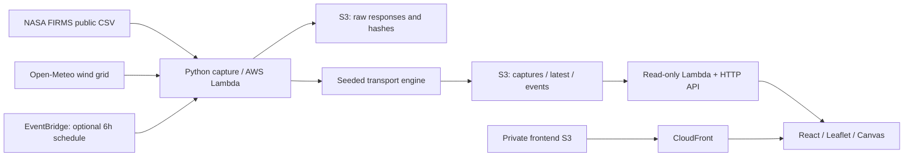

# BreatheAhead

**See pollution move. Source → Transport → Potential influence.**

Built for the Air track of Environmental Hacks, October 8–11, 2026. An interactive map connects real satellite thermal anomalies with a simplified wind-driven particle simulation over northern India and its upwind surroundings.

## Current implementation

- React + TypeScript + Leaflet map; animated wind field, smoke particles, selectable locations and detections, layer switches, 0–24 hour playback.
- Select a detection to trace its modeled mean particle pathway and displacement; inspect source groups contributing modeled particles near a city.
- Compare seven locations on a common particle-count scale, with peak timing and first modeled proximity.
- Four-chapter guided tour and presentation view; inspect capture timestamps, input hashes and the AWS pipeline in the provenance panel.
- Real NASA FIRMS Suomi NPP VIIRS detections and Open-Meteo forecast winds, captured with raw responses and SHA-256 provenance.
- Deterministic Python transport engine shared by local ingestion and AWS Lambda.
- Offline captured-run replay with a saved event index. Local geography is bundled; map tiles and API keys are not required.
- Timestamped ground-observation CSV importer; no fabricated readings or comparison claims.
- AWS SAM infrastructure and deployment script: EventBridge, ingestion Lambda, private S3, read-only API Gateway/Lambda, private static S3 + CloudFront.

**Deployment status:** deployed to AWS in `ap-south-1` on October 9, 2026: [open BreatheAhead](https://d2du2xm4yef86k.cloudfront.net/). The hosted UI loads real captured detections from the AWS API; the first verified capture contained 117 detections. The six-hour capture schedule is disabled. No model validation, real-time ground feed, historical pollution-event validation, Bedrock integration, or final demo video is claimed.

The bundled capture contains **193 real detections**, nine wind points and 25 hourly frames. It was retrieved on **October 8, 2026 at 20:28 IST**, with a model start of **14:30 IST**. It is a captured run, never described as current live conditions. The rectangular source domain includes nearby parts of Pakistan; coordinates are not classified as Indian agricultural fires.

## Run locally

Requires Node.js 22+ and Python 3.12+.

```powershell
npm ci
npm run dev
```

Open the URL printed by Vite (normally `http://127.0.0.1:5173`). The initial app reads the committed capture under `public/data`; no cloud setup is needed. Once loaded, the data and geography need no external API. Fonts optionally load from Google Fonts and fall back to system fonts offline.

```powershell
npm test
npm run build
npm run preview
```

Refresh public data with network access:

```powershell
npm run data:refresh
```

This fetches NASA's South Asia 24-hour feed, filters the study domain, fetches matching Open-Meteo wind timestamps, runs the model, and saves a new capture. Failed upstream requests or missing winds leave the previous capture intact. A no-detections response currently preserves the old capture and reports an error, rather than silently presenting it as a new empty forecast. Use the UI's reload button after a successful refresh. Re-open the page to refresh the event menu.

Optional local API:

```powershell
npm run api
# In another PowerShell session:
$env:VITE_API_URL = '/api'
npm run dev
```

Vite proxies `/api` to `127.0.0.1:8000`. Remove that environment variable to return to file-backed capture mode. The local API is read-only; data refresh happens through the CLI.

## Architecture



Local development uses the same Python capture and model modules, filesystem storage and a stdlib HTTP server. No DynamoDB or LLM is needed for this slice.

## Model methodology

1. Filter detections to 28–32.5° N and 73.5–78° E. Deduplicate identical coordinates and acquisition times. If there are over 240 detections, deterministically select evenly spaced records; disclose both counts.
2. Set the pulse-release time to the next whole UTC hour after the latest detection. **All detections are assumed to release together**, including earlier detections from the 24-hour feed. This is a demonstrator assumption, not inferred fire duration.
3. Fetch hourly 10 m wind speed (m/s) and meteorological direction from nine points spanning 26–33° N, 72–80° E, for the entire 24-hour run. Preserve actual weather model grid coordinates.
4. Convert directions **from** north into velocity: `u = -speed × sin(direction)`, `v = -speed × cos(direction)`. Interpolate vectors in time and use inverse-distance-squared spatial weights.
5. Advance eight equal-weight particles per detection every 15 minutes. Convert meters to latitude/longitude with a cosine correction; add seeded Gaussian dispersion with standard deviation `sqrt(2 × K × dt)`, `K = 350 m²/s`. Random seed: 42.
6. Use a 12-hour exponential weight decay for illustrative fading. Drop particles that leave the weather grid. Save hourly frames.
7. Report particle counts within 25 km of selected city coordinates. First proximity can be **present at start**, never a made-up transport ETA. Counts depend on particle sampling and are not a concentration or calibrated probability.

There is no plume rise, vertical mixing, terrain-resolved wind, chemistry, emission-rate estimation, calibrated deposition, or uncertainty ensemble. Near-surface winds can differ substantially from winds transporting elevated smoke. FRP is displayed as source metadata, **not converted into emissions**. Thermal anomalies alone cannot identify crop-residue burning or establish the cause of city pollution. Open-Meteo winds are numerical weather output, not station observations. Neither particle counts nor their weights are AQI, PM2.5, dose, or health guidance.

## Data and provenance

| Data | Provider | Treatment |
|---|---|---|
| Thermal anomalies | [NASA FIRMS active fire downloads](https://firms.modaps.eosdis.nasa.gov/active_fire/) | Public Suomi NPP VIIRS C2 South Asia CSV; actual confidence metadata preserved |
| Meteorology | [Open-Meteo Weather API](https://open-meteo.com/en/docs) | Hourly 10 m winds; response URL and hash saved; [CC BY 4.0 attribution](https://open-meteo.com/en/terms) |
| Older wind captures | [Historical Forecast API](https://open-meteo.com/en/docs/historical-forecast-api) | Used when the source anchor is older than the recent forecast window |
| Geographic outlines | [Natural Earth](https://www.naturalearthdata.com/about/terms-of-use/) | Public-domain 110m country outlines; approximate orientation, not authoritative boundaries |
| Ground PM2.5 | Not connected | No fabricated values; import externally verified measurements below |

`data/raw/` preserves original fire and wind responses. `public/data/capture-*.json` contains a reproducible processed run, its inputs, metadata and derived frames. `latest.json` is the default capture; `events.json` indexes saved replays. Public payloads contain only environmental data. Raw NASA regional data includes detections outside the app's filtered domain.

New capture IDs include a UUID suffix, so repeating ingestion at the same model start hour preserves separate runs and raw responses. Older IDs remain readable. The replay menu displays both model start and capture time.

## Ground observations

Obtain timestamped, quality-checked measurements from a legitimate provider such as OpenAQ or a monitoring agency. Do not use forecast PM2.5 as a ground measurement. The importer requires a CSV with these columns (no sample measurements are shipped):

```csv
station,latitude,longitude,time,pm25,unit,source_url
```

`time` must contain `Z` or an explicit UTC offset; unit must be `ug/m3` or `µg/m³`; `source_url` must identify the HTTPS source. Negative/nonfinite values and duplicate station/time records are rejected. Only measurements overlapping the run are retained.

```powershell
python -m backend.import_observations path/to/real-measurements.csv
```

Turn on **Ground observations**. Blue markers appear only within ±30 minutes of the selected frame; hover for measurement and timestamp. This provides visual timing comparison. It does **not** establish model accuracy or causal attribution. Do not announce validation until a pre-specified comparison across independent events has been performed. A later fresh capture does not automatically reuse older observations.

## AWS deployment

For a detailed Windows PowerShell guide covering account checks, installs, SSO, deployment, verification, costs, troubleshooting and teardown, see [the AWS deployment walkthrough](docs/aws-deployment.md).

Install the official AWS CLI v2 and AWS SAM CLI, and configure the intended account locally (prefer SSO). Never put credentials in this repository or chat. With the existing `breathe-ahead` profile:

```powershell
./scripts/deploy.ps1 -Profile breathe-ahead -Region ap-south-1
# Optional: enable recurring real ingestion every six hours
./scripts/deploy.ps1 -Profile breathe-ahead -Region ap-south-1 -EnableSchedule
```

The script checks the AWS identity, runs tests, stages **only backend Python files**, builds/deploys SAM, invokes a real ingestion Lambda, builds the frontend against the returned API URL, uploads it to the private website bucket, invalidates CloudFront, and checks the API health and forecast shape. The schedule is off by default. Failed ingestion stops the script before it presents deployment as successful. The deployment completed successfully on October 9, 2026; the hosted UI and replay were verified against the AWS API.

Both buckets block public access and use server-side encryption. CloudFront accesses the website bucket through origin access control. Read-only API routes are public and throttled. Lambda ingestion has write access to the data bucket; the API has read-only access. Raw files expire after 30 days; processed captures are retained. SAM and AWS usage can incur charges. Set an AWS budget appropriate to the available hackathon credits; disable scheduling when no longer needed. Buckets are retained if the stack is deleted, so remove retained objects and buckets deliberately when the project is finished.

Routes: `/health`, `/forecast`, `/sources`, `/wind`, `/locations`, `/observations`, `/events`, `/replay/{capture-id}`. Health reports the runtime, not scientific validation or upstream freshness. The frontend shows the capture timestamp even when served by AWS.

## Tests and demo

`npm test` covers wind-direction convention, velocity units, decay, seed repeatability, calm winds, missing coverage, interpolation across 0°/360°, out-of-domain behavior, ingestion normalization, replay-path validation, observation metadata, and the committed capture contract.

The frontend analysis tests reconcile source groups against every saved city count, verify tracing after particles leave the domain, check peak/first-proximity timing, and verify that wind arrows use the Python model's kilometer-based weighting.

See [docs/demo.md](docs/demo.md) for the ≤3-minute walkthrough, [docs/project-review.md](docs/project-review.md) for the demo improvements and remaining gaps, and [docs/execution-status.md](docs/execution-status.md) for remaining submission work. The supplied [info.md](info.md) is the event brief; [temp-plan.md](temp-plan.md) is preserved as the original plan.
