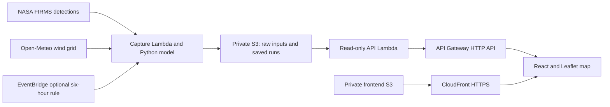

# BreatheAhead

**Trace potential smoke pathways from satellite detections.**

Built solo by **Roopal** for the **Air track of Environmental Hacks 2026**.

[Open the deployed app](https://d2du2xm4yef86k.cloudfront.net/) · [Demo recording script](docs/demo.md) · [Visitor test walkthrough](docs/visitor-qa-walkthrough.md)

BreatheAhead combines real NASA FIRMS thermal-anomaly detections with Open-Meteo winds to explore how particles released from those locations could move across northern India and its upwind surroundings. An interactive map makes the sources, wind field, modeled pathways, and differences between locations visible together.

Environmental students, researchers, and civic groups can use it to inspect transport hypotheses and the evidence behind a captured run. Ground measurements and scientific evaluation are the next step before using it for operational decisions.

## Try the demo

1. Open **Guided tour** to see four chapters: sources, a modeled pathway, location comparison, and capture evidence.
2. In **SOURCES**, select a fire detection and inspect its acquisition time, confidence, and radiative power. Click **Follow this source** to trace the mean position of its modeled particles.
3. In **FORECAST**, use Play, the hour slider, and layer switches to inspect the saved 24-hour transport run.
4. Click a location card to inspect its peak particle proximity. Compare seven locations on one shared chart scale, then select a contributing model source group.
5. Open **Capture & provenance** for timestamps, input hashes, provider URLs, and the AWS delivery pipeline. Use **REPLAY** to revisit saved runs.

The hosted capture can refresh, so use the timestamp and count displayed in the app. The repository includes a real October 8 capture for reproducible local review.

## What is implemented

- Selectable satellite detections, cities, animated wind, modeled particles, starting-position rings, and source-path tracing.
- Twenty-five hourly frames over a 24-hour horizon, playback, seven location comparisons, and first/peak modeled proximity.
- Guided tour, presentation view, mobile layout, keyboard-operable marker buttons, and evidence dialogs.
- Real input capture with raw responses, SHA-256 hashes, acquisition times, retrieval times, and unique saved-run IDs.
- One Python capture/model pipeline shared by local development and AWS Lambda.
- Timestamped CSV import for verified ground observations; the shipped capture has no connected station measurements.

**Interpretation:** particle proximity is potential influence. It is not PM2.5, AQI, exposure dose, or measured source attribution. Detections are captured thermal anomalies and do not establish fuel type. The model uses coarse 10 m winds and a simultaneous equal-weight pulse; scientific accuracy has not been evaluated. See [methodology and limitations](docs/methodology.md).

## Tech stack and AWS architecture

| Component | Implementation |
|---|---|
| Interface | React 19, TypeScript, Vite, Leaflet, Canvas, Lucide icons |
| Capture and transport | Python 3.12; standard-library data ingestion and seeded particle simulation |
| Public inputs | NASA FIRMS Suomi NPP VIIRS C2; Open-Meteo hourly 10 m winds |
| Infrastructure | AWS SAM template deployed through AWS CloudFormation; AWS SAM CLI and AWS CLI v2 |
| Hosting and API | Amazon S3, Amazon CloudFront, Amazon API Gateway HTTP API, AWS Lambda |
| Automation and access | Amazon EventBridge scheduled rule; AWS IAM roles and CloudFront origin access control |



The current app is deployed in **ap-south-1 (Mumbai)**. The API supplies captures and replay data; it does not invoke ingestion when a visitor presses Reload. EventBridge can run capture every six hours. The template defaults to a disabled schedule; deployment checks the actual rule state. Earlier deployed stacks need the corrected template redeployed to honor that default.

Private buckets block public access and use server-side encryption. CloudFront reads the frontend through origin access control. The API is public and read-only, with request throttling; its Lambda role has S3 read permission, while the capture role can write capture data.

## Run locally

Requires **Node.js 22+** and **Python 3.12+**. No API key, AWS account, Docker, or third-party Python package is needed for the bundled replay.

```sh
npm ci
npm run dev
```

Open the address Vite prints, normally `http://127.0.0.1:5173`. On Windows PowerShell, use `npm.cmd` if script execution policy blocks `npm`.

```sh
npm test
npm run build
npm run preview
```

`npm test` runs Python model/pipeline tests and frontend analysis tests. They cover wind conventions and units, deterministic dispersion, decay, missing wind coverage, ingestion failures, capture preservation, replay paths, observation metadata, source-group counts, pathway summaries, location timing, and wind-rendering consistency. These checks verify implementation behavior; they are not environmental validation.

Refresh real inputs with network access:

```sh
npm run data:refresh
```

A successful capture saves a new run and its raw inputs. Upstream failures, invalid winds, or an empty detection feed preserve the previous snapshot and report an error. Reload the captured data in the UI afterward.

For the optional local API and verified observation import, see [methodology and data](docs/methodology.md) and [deployment instructions](docs/aws-deployment.md).

## Deploy to AWS

Install AWS CLI v2 and AWS SAM CLI, configure a deployment profile, and follow the [complete PowerShell deployment guide](docs/aws-deployment.md).

```powershell
.\scripts\deploy.ps1 -Profile YOUR_PROFILE -Region ap-south-1
# Optional recurring capture:
.\scripts\deploy.ps1 -Profile YOUR_PROFILE -Region ap-south-1 -EnableSchedule
```

The script tests the project, packages only backend Python files, deploys the SAM stack, checks scheduling, publishes a real capture, builds the frontend against the API URL, uploads to S3, invalidates CloudFront, and verifies API responses. The [frontend publication script](scripts/publish-frontend.ps1) supports UI-only updates to an existing stack.

AWS usage can incur charges. Check credits and budgets, and verify the capture rule state. Raw S3 inputs expire after 30 days; processed captures and both buckets are retained until deliberately cleaned up. Teardown instructions are in the deployment guide.

API routes: `/health`, `/forecast`, `/sources`, `/wind`, `/locations`, `/observations`, `/events`, `/replay/{capture-id}`. Health verifies the API runtime; capture timestamps indicate input age.

## Repository guide

| Path | Purpose |
|---|---|
| `src/` | UI, map rendering, source tracing, and location analysis |
| `backend/` | Input capture, transport model, read-only API, Lambda handlers, and observation importer |
| `infra/` | AWS SAM infrastructure and runtime dependency declaration |
| `scripts/` | Backend packaging, AWS deployment, and frontend publication |
| `tests/` | Model, pipeline, and frontend-analysis checks |
| `public/data/` | Real bundled replay, event index, and geographic outlines |
| `data/raw/` | Original provider responses for the bundled capture and hash verification |
| `docs/` | Methodology, deployment, video narration, and visitor QA |

Planning notes, generated builds, dependencies, local deployment output, and credentials are excluded from the current repository tree. Existing commit history is preserved.

## Data attribution and next steps

Detections: [NASA FIRMS](https://firms.modaps.eosdis.nasa.gov/active_fire/). Winds: [Open-Meteo](https://open-meteo.com/) under [CC BY 4.0](https://open-meteo.com/en/terms). Geographic outlines: [Natural Earth public-domain data](https://www.naturalearthdata.com/about/terms-of-use/); boundaries are approximate.

Next steps are matching verified station measurements, defining an evaluation across independent events, adding winds at smoke-relevant heights, and testing uncertainty across model assumptions. The observation importer already preserves measurement timestamps and source URLs.
